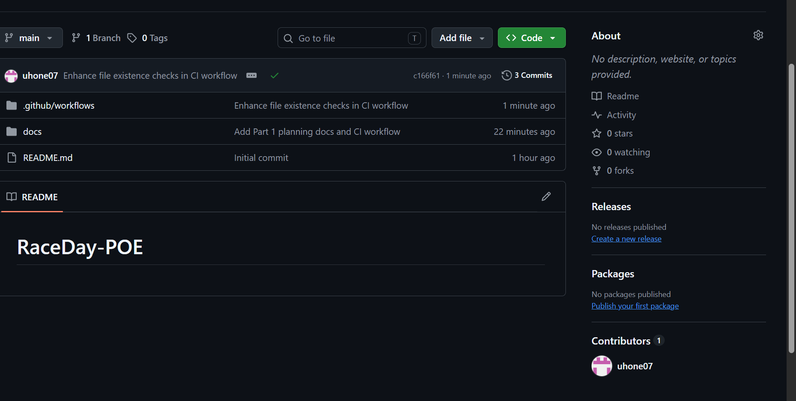

# RaceDay-POE

RaceDay is a full-stack web-based event management system built for the South African road running, walking, and cycling community. It allows Event Organisers to create and manage events, categories, and participant results, while Participants can browse upcoming events, enter events, and track their personal performance history.

This repository contains the Portfolio of Evidence (POE) for PROG6212, submitted in three parts:

- **Part 1:** System planning: ERD, API endpoint plan, and SQL database script
- **Part 2:** RESTful API built in C# with unit tests and CI/CD (this submission)
- **Part 3:** MVC web application with Azure Blob Storage and Docker

## User Roles

- **Organiser**: can create, edit, and delete events, manage event categories, capture participant results, and view all enrolments for their own events.
- **Participant**: can create an account, browse events, enter an event by selecting a category, view their own enrolments, and view their own results.

Roles are chosen at registration and stored in a server-side session on login. Role checks are enforced on every protected endpoint by the `SessionAuthorize` attribute (401 if not logged in, 403 if the role is wrong). Organisers can only change events, categories, enrolment lists and results that belong to events they created.

## Repository structure

| Folder | Contents |
|---|---|
| `docs/` | Part 1 planning documents (ERD, endpoint plan, SQL script) and CI screenshots |
| `RaceDay.Api/RaceDay.Api/` | Part 2 ASP.NET Core Web API (controllers, models, DTOs, data, services, migrations) |
| `RaceDay.Api/RaceDay.Api.Tests/` | Part 2 xUnit test project |
| `.github/workflows/` | GitHub Actions CI workflow |

## Part 2: RESTful API

### Tech
ASP.NET Core Web API (.NET 10), Entity Framework Core (Code-First) with SQL Server, session-based authentication, PBKDF2 password hashing with a random salt, Swagger UI (Swashbuckle), xUnit with an in-memory database for tests.

### Setup and run
1. Install the .NET 10 SDK, Visual Studio, and SQL Server (Express is fine).
2. Clone the repository.
3. Open `RaceDay.Api/RaceDay.Api.slnx` in Visual Studio.
4. In `RaceDay.Api/RaceDay.Api/appsettings.json`, set `ConnectionStrings:DefaultConnection` to your own SQL Server instance. Mine is `Server=PENELOPE\SQLEXPRESS;Database=RaceDayDB;Trusted_Connection=True;TrustServerCertificate=True;`.
5. Create the database. In **Tools > NuGet Package Manager > Package Manager Console**, with the default project set to `RaceDay.Api`, run:
```
   Update-Database
```
6. Press the green **https** button to run the API.
7. Open `https://localhost:<port>/swagger`. The port is shown in the console output (it was 7023 on my machine).

To use the protected endpoints in Swagger: call **POST /api/auth/register**, then **POST /api/auth/login**. Swagger keeps the session cookie, so later calls are authenticated.

### Endpoints
- **Auth:** register, login, logout
- **Profile:** view and update own profile
- **Events:** list/filter, view, create, update, delete (Organiser for changes)
- **Categories:** list per event, create, update, delete (Organiser for changes)
- **Enrolments:** enrol (Participant), my enrolments (Participant), event enrolments (Organiser), cancel (Participant)
- **Results:** save result (Organiser), event results (Organiser), my results (Participant)

All endpoints are visible and documented in Swagger UI.

### Unit tests
Tests live in `RaceDay.Api/RaceDay.Api.Tests` and run the real API in memory with an in-memory database. They cover:
- Registration and login (success, duplicate email, invalid role, wrong password, logout)
- Event management by Organisers (create, update, delete, ownership checks)
- Role rejection (Participant gets 403, anonymous user gets 401)
- Event enrolments (Participant can enrol and the enrolment is recorded; duplicates and wrong category are rejected)

Run them in Visual Studio with **Test > Run All Tests**, or from the command line:
```
dotnet test RaceDay.Api/RaceDay.Api.slnx
```

### Deviations from Part 1
- The database is now created by EF Core migrations. The EF schema follows the Part 1 ERD (same six tables, keys and relationships), but column types differ slightly (EF uses `nvarchar` for text and `datetime2` for dates, where the SQL script uses `varchar` and `datetime`).
- Sample data from the Part 1 SQL script is not loaded by migrations. Test data is created through the API.
- ENDPOINT DIFFERENCES: (fill in any routes that differ from `docs/RaceDay_API_Endpoint_Plan.md`, or delete this line if there are none)

### Known limitations
- Anyone can choose the Organiser role at registration. A real system would use an invite code or admin approval.
- Sessions are stored in server memory, so they reset when the API restarts.

### AI use disclosure
I used an AI assistant (Claude) for step-by-step guidance while building Part 2, including help with project setup, code structure, debugging errors, and drafting this README. I reviewed, ran and tested the code and can explain it in my video.

## CI/CD

A GitHub Actions workflow validates the repository structure, builds the API, and runs all unit tests on every push.

Part 1 build:



Part 2 build and tests:


## Video Presentations

- [Part 1 walkthrough](https://youtu.be/Pi1sjD3rQZ4)
- Part 2 walkthrough: PASTE YOUR UNLISTED YOUTUBE LINK HERE