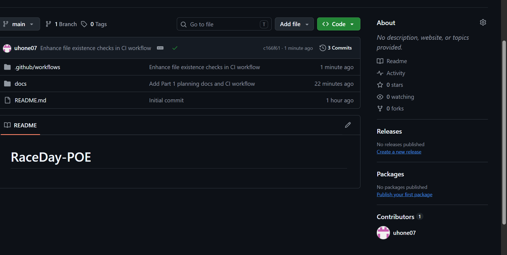

# RaceDay-POE

RaceDay is a full-stack web-based event management system built for the South African road running, walking, and cycling community. It allows Event Organisers to create and manage events, categories, and participant results, while Participants can browse upcoming events, enter events, and track their personal performance history.

This repository contains the Portfolio of Evidence (POE) for PROG6212, submitted in three parts:

- **Part 1:** System planning: ERD, API endpoint plan, and SQL database script
- **Part 2:** RESTful API built in C# with unit tests and CI/CD
- **Part 3:** ASP.NET Core MVC web application that consumes the API, with Azure Blob Storage and Docker (this submission)

## User Roles

- **Organiser**: can create, edit, and delete events, manage event categories, capture participant results, and view all enrolments for their own events.
- **Participant**: can create an account, browse events, enter an event by selecting a category, view their own enrolments, and view their own results.

Roles are chosen at registration and stored in a server-side session on login. Role checks are enforced on every protected endpoint (401 if not logged in, 403 if the role is wrong). Organisers can only change events, categories, enrolment lists and results that belong to events they created.

## Repository structure

```
RaceDay.Api/
  RaceDay.Api/          ASP.NET Core Web API (business logic, database, Azure Blob Storage)
  RaceDay.Api.Tests/    Unit tests for the API
  RaceDay.Web/          ASP.NET Core MVC front end (Part 3) + Dockerfile
docs/                   ERD, SQL script, endpoint plan, screenshots
.github/workflows/      CI workflow
```

## Part 2: RESTful API

### Setup and run
1. Install the .NET 10 SDK, Visual Studio, and SQL Server (Express is fine).
2. Clone the repository and open `RaceDay.Api/RaceDay.Api.slnx` in Visual Studio.
3. In `appsettings.json`, set `ConnectionStrings:DefaultConnection` to your own SQL Server instance.
4. In the Package Manager Console, run `Update-Database` to create the database.
5. Press the green **https** button to run the API.
6. Open `https://localhost:<port>/swagger` (the port is shown in the console output).

To test protected endpoints in Swagger: call **POST /api/auth/register**, then **POST /api/auth/login**.

### Unit tests
Run them in Visual Studio with **Test > Run All Tests**. They cover registration and login, event management by Organisers, role rejection, and event enrolments.

## Part 3: MVC web application

The `RaceDay.Web` project is an ASP.NET Core MVC application styled with Bootstrap and a RaceDay sporting theme. **It never touches the database or Azure directly.** All data, business rules and image storage go through the Part 2 API, so no business logic is duplicated in the front end.

### How the web app works with the API
- **Authentication:** register, login and logout are sent to the API. The API's session cookie is stored in the MVC session and sent with every later API call (`Services/ApiClient.cs`), so a user's role comes from the API's session.
- **Role-specific interfaces:** a `[RequireRole]` filter sends logged-out users to the login page and users with the wrong role to an "Access denied" page. The navigation menu changes with the role.
- **Errors:** form validation (data annotations) and the API's error messages are shown to the user as friendly messages. Invalid input never crashes the site.
- **Enrolment status colours:** Confirmed is green, Pending is amber, Cancelled is red.

### Organiser features
- Dashboard with events created, upcoming events, total enrolments and enrolments awaiting confirmation
- Create, edit and delete events, including **banner image upload**
- Manage categories per event (name, age range, distance)
- View enrolments per event and confirm or cancel them
- Capture and edit results (finish time, position, total finishers)

### Participant features
- Home page with upcoming events and filters
- Event details with categories, and enrolment in a category
- My enrolments with colour-coded status, and cancel an enrolment
- My results (for example "47th out of 312")
- Profile with **profile picture upload**

### Azure Blob Storage
Images (event banners and profile pictures) are stored in **Azure Blob Storage**. This is done **only in the API**: the MVC app sends the image to the API, the API uploads it to Azure and returns the public URL, which is then saved on the event or profile.

New API endpoints added in Part 3 (a deviation from the Part 1 endpoint plan, added to support image storage):

| Method | Route | Who | Purpose |
|---|---|---|---|
| POST | `/api/uploads/event-banner` | Organiser | Upload an event banner image, returns `{ "url": "..." }` |
| POST | `/api/uploads/profile-picture` | Any logged-in user | Upload a profile picture, returns `{ "url": "..." }` |

Uploads accept JPG, PNG, WEBP or GIF up to 5 MB.

**Configuration (secrets are never committed):** the API reads the storage connection string from configuration. For local development use .NET User Secrets: right-click `RaceDay.Api` > **Manage User Secrets** and add:

```json
{
  "AzureBlob": {
    "ConnectionString": "<your storage account connection string>",
    "ContainerName": "raceday-images"
  }
}
```

The storage account needs **Allow Blob anonymous access** enabled so the uploaded images can be displayed on the website. The container `raceday-images` is created automatically on the first upload.

### Run the web app locally
1. Set up the API as described in Part 2 and add the Azure secrets above.
2. In `RaceDay.Web/appsettings.json`, `ApiBaseUrl` points to the API (default `http://localhost:5027/`).
3. In Visual Studio, right-click the solution > **Configure Startup Projects**, choose **Multiple startup projects**, and set `RaceDay.Api` and `RaceDay.Web` to **Start**.
4. Press **Start**. The website opens (for example `https://localhost:7117`).
5. Register an Organiser and a Participant account to try both roles.

### Run with Docker
The web app has a `Dockerfile` in `RaceDay.Api/RaceDay.Web`. The container runs the MVC site and calls the API running on the host machine, so the behaviour matches running it locally.

1. Install Docker Desktop and make sure it is running.
2. Start the API locally (see above) so it is listening on `https://localhost:7023`.
3. Build the image:

```
cd RaceDay.Api/RaceDay.Web
docker build -t raceday-web .
```

4. Run the container:

```
docker run --rm -p 8080:8080 -e ApiBaseUrl=https://host.docker.internal:7023/ -e ApiTrustAnyCertificate=true raceday-web
```

5. Open `http://localhost:8080` in your browser.

`ApiTrustAnyCertificate=true` is only for local development: it lets the container accept the API's local development HTTPS certificate.

## CI/CD

A GitHub Actions workflow validates the repository structure, builds the API **and the MVC web application**, and runs all unit tests on every push.



PASTE A SCREENSHOT OF THE GREEN PART 3 CI RUN HERE

## AI use disclosure
I used an AI assistant (Claude) for step-by-step guidance while building Parts 2 and 3, including project setup, code structure, debugging, Azure and Docker setup, and drafting this README. I reviewed, ran and tested the code and can explain it.

## Video Presentations

- [Part 1 walkthrough](https://youtu.be/Pi1sjD3rQZ4)

- [Part 3 walkthrough](https://youtu.be/4HikypA-wdw)
